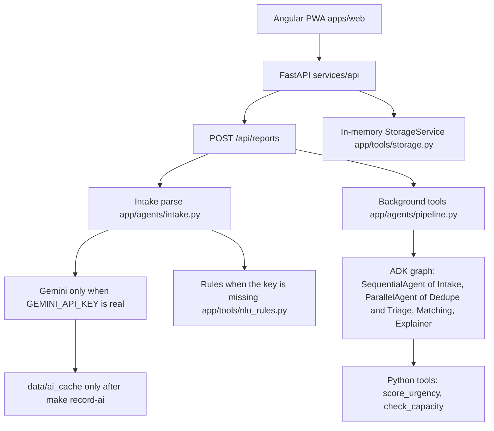

# Relief Desk

**Decision support for crisis responders: who to help first, and why.**
A multilingual crisis-reporting and coordination prototype built for the Google Cloud AI Builder Cup 2026 (theme: Sustainability & Social Impact).

> **Prototype. Not an emergency service. In an emergency call 112.** All data in this repository is synthetic.

Live demo: `<URL to add>` | Demo video: `<link to add>` | Coordinator demo login: see Demo section

## Demo
One PWA, two roles. Open the live URL: **"I need help / report"** needs no login. **"I'm a coordinator"** goes to `/coordinator/login`.
Demo coordinator (synthetic, demo-only): email `demo-coordinator@reliefdesk.internal` / password `KeralaRelief2026!` (created by `scripts/seed.py`).
Side-by-side demo mode: add `?demo=1` on desktop.

## The problem
In floods and other disasters, coordinators are buried in noisy messages: the same request arrives many times, updates get lost, rumours mix with real calls, and the most vulnerable people can be lost in a first-come-first-served queue. Reports of past floods in Kerala (2018) and Chennai (2015) describe duplicate entries, stale requests and a hoax. `<add sources before publishing>`

## What it does
- **Report** by text in English, Hindi, Hinglish, or Tamil, or by a canned synthetic voice note. See what the system understood, then track status. Gemini Live voice is not built.
- **Understand:** Intake validates a structured request (type, place, people, vulnerable people, urgency) and keeps the original message. With a real `GEMINI_API_KEY`, that call goes to Gemini. With no key, the same fields come from the deterministic rules.
- **Dedupe:** merges duplicates with visible evidence; treats "now 5 people" as an update that raises urgency; every merge can be undone or split.
- **Rank:** vulnerability-weighted urgency with a plain-language reason, adjustable weights and an audit log.
- **Match:** seeded boats, shelters, food and medical resources, scored on distance, capacity, urgency and vulnerability. Capacity drops as dispatches are approved, and over-commitment is warned. **A human coordinator approves every dispatch.**
- **Protect:** trust levels, rate limits, conflict flags and stale-request rechecks flag problems for a human; nothing is auto-deleted.
- **Public map:** area-level incidents only. No names, phone numbers or exact addresses.

Designed around scenario packs: flood is the main demo; a dog-attack pack (synthetic) is optional; other crises can be added by configuration.

## How it works

The running prototype is the Angular app talking to the FastAPI process. Cases live in memory. Cloud Run is a deploy recipe in `deploy/cloudrun.md`, not a live URL.



The ADK objects are constructed with `google-adk==2.11.0`. After submit, a background thread runs the scoring and capacity tools and writes `case.trace`. CI does not call the ADK Runner. A model call happens only when the key is real, and that path was not scored on the frozen split.

### How we use ADK

| Agent | ADK type | File | Model may | Code keeps |
|---|---|---|---|---|
| Intake | `LlmAgent`, `output_key=intake` | `services/api/app/agents/pipeline.py` | Read the report into facts | Rule repair of type, people, ward, and hoax in `app/agents/intake.py` |
| Dedupe | `LlmAgent` inside `ParallelAgent` | `pipeline.py`, `app/agents/dedupe.py` | Return duplicate, update, or distinct plus evidence | Lexical match when embeddings or the judge are unavailable |
| Triage | `LlmAgent` plus `FunctionTool(score_urgency)` | `pipeline.py`, `app/tools/scoring.py` | Repeat the tool score | The urgency number |
| Matching | `LlmAgent` plus `FunctionTool(check_capacity)` | `pipeline.py` | Propose a team | Capacity. The tool does not dispatch |
| Explainer | `LlmAgent`, `output_key=explainer` | `pipeline.py` | Two plain sentences | Medical and legal sentences are stripped in `app/llm/guards.py` |
| DispatcherAssist | `LlmAgent`, `output_key=dispatch_proposal` | `app/agents/dispatcher.py` | Call list, find, capacity, propose, hold | `commit_dispatch` is a `FunctionTool` with `require_confirmation=True` |

ADK 2.11 warns that `SequentialAgent` and `ParallelAgent` are deprecated in favor of `Workflow`. They still construct, and they are the graph this prototype builds. `Workflow` cannot yet be a sub-agent of an `LlmAgent`.

### Where Gemini is used

| Job | Config | File | What was measured |
|---|---|---|---|
| Intake JSON | `GEMINI_MODEL` default `gemini-3.8-flash` | `app/llm/client.py`, `app/agents/intake.py` | Mocked in `tests/test_gemini_live.py`. Live smoke skips unless `GEMINI_API_KEY` is a real key |
| Duplicate judge | `GEMINI_MODEL` | `app/agents/dedupe.py` | Mocked in `tests/test_embedding_dedupe.py` |
| Embeddings | `GEMINI_EMBED_MODEL=gemini-embedding-001`, task `SEMANTIC_SIMILARITY`, 768-d | `app/llm/embeddings.py` | Mocked. No key returns no vector and the lexical fallback runs |
| Explainer text | `GEMINI_MODEL` | `app/agents/explainer.py`, `pipeline.py` | The stored note is the tool sentence plus "not medical or legal advice" unless a live call replaces it. Not scored on the split |
| Assist dispatcher | `GEMINI_MODEL` | `app/agents/dispatcher.py` | Tool order, reject, and the two-coordinator hold are tested without a model call |
| Benchmark column | `GEMINI_MODEL` | `bench/gemini_eval.py` | `measured: false`, reason `no_api_key`, n=168, date 2026-10-11 |
| Recorded replay | `AI_MODE=replay` | `data/ai_cache`, `scripts/record_ai.py` | The directory in git has no transcripts. `make record-ai` writes them only after a real call |
| Health | none | `GET /api/health/ai` in `app/api/health.py` | Returns provider, model, cache hit rate, and quota. It does not return the key |

Not built: Gemini Live voice, Search grounding, Malayalam, photo intake, Pub/Sub, BigQuery.

## Benchmark (synthetic, our own labels)

`make bench` runs `bench/run_bench.py` on the frozen test split in `data/synthetic/flood_v1/split.json` (seed 42). The held-out ids are MSG-0073 through MSG-0240 (n=168). Rules were not edited from the misses on this split. Source: `bench/results/RESULTS.md`, generated 2026-10-11.

| Metric | Rule pipeline | Baseline | Gemini |
|---|---|---|---|
| Type accuracy | 67.3% | Keyword 16.3% | not measured (`no_api_key`) |
| Ward accuracy | 100.0% | Keyword 13.3% | not measured |
| People-count exact | 79.5% | Keyword 65.4% | not measured |
| Vulnerable-flag F1 | 58.5% | Keyword 39.4% | not measured |
| Duplicate precision / recall / F1 | 95.5% / 46.7% / 62.7% | Hash 10.0% / 4.4% / 6.2% | not measured |
| Duplicate-vs-update accuracy | 61.2% | n/a | not measured |
| Critical-case share in top 5 | 60.0% | First-come 0.0% | not measured |
| Hoax/spam catch rate | 100.0% | 0.0% | not measured |

The type target is 90%. This split is at 67.3%. Of 32 type misses, the rule read rescue when the label said medical (10), food (8), shelter (6), or info (5). The ward target is 85%. This split is at 100.0% because the ward comes from the gazetteer. The `$0.0465` per 1,000 messages in `RESULTS.md` is an estimate from assumed token counts and a Gemini 2.5 Flash price card. It is not a measured invoice, and Gemini was not called. These figures are synthetic labels, not real-world accuracy. The Accuracy page reads `bench/results/latest.json`.

## Safety and limitations
- Decision support only; humans approve every dispatch; no auto-dispatch or auto-delete.
- Synthetic data only; no real personal data is collected or stored.
- Dog-attack pack shows only fixed official first-aid wording; no medical advice.
- Language and place understanding can be wrong; the UI shows the original message and confidence.
- Per-user rate limits and spend caps protect the public endpoint.

## Run locally
```bash
cp .env.example .env     # add your own settings; never commit secrets

# API, from services/api
python -m uvicorn app.main:app --host 127.0.0.1 --port 8000

# PWA, from the repo root. The workspace has more than one project, so name it:
npx ng serve web --port 4200
npx ng build web

# synthetic coordinator account
python scripts/seed.py

# put the running API back to the synthetic Kerala demo (seeds load again)
python scripts/reset_demo
```
`ng build` without `web` fails because the Angular workspace has two projects. Use `npx ng build web`.

### Live Gemini versus the recorded demo

`DEMO_MODE=true` still loads the synthetic scenario and the demo login. It does not block Gemini. A real `GEMINI_API_KEY` calls the model named by `GEMINI_MODEL` (currently `gemini-3.8-flash`, from the Gemini models page dated 2026-10-09). No key, a placeholder key, or `GEMINI_ENABLED=false` uses the deterministic fallback. The case stores `ai.provider` as `gemini`, `cache`, or `fallback`, and the AI reading line shows Gemini, Recorded Gemini run, or Offline fallback.

`data/ai_cache` is empty in git. `make record-ai` writes it only after a real key returns Gemini JSON for the seeded reports. `AI_MODE=replay` serves those files as Recorded Gemini run. A new report that is not in the cache still calls Gemini when a key is set.

Set the key only in `.env`. Do not commit it.

```
GEMINI_ENABLED=true
GEMINI_API_KEY=your-key
AI_MODE=auto
```

A timeout, a 429, or invalid JSON after one repair retry uses the deterministic fallback and records `ai.fallback_reason`. CI mocks the client and does not call Gemini.

## Deploy

There is no live Cloud Run URL in this repo. `deploy/cloudrun.md` is the recipe: a root `Dockerfile`, `GEMINI_API_KEY` injected from Secret Manager as an environment variable, and the note that case rows stay in process memory. Firestore is not the store this process writes.

## Built with

Angular, Ionic, Capacitor, FastAPI, `google-adk==2.11.0`, `google-genai==2.29.0`. Model id `gemini-3.8-flash` and embedding id `gemini-embedding-001` come from the Gemini docs (models page dated 2026-10-09, embeddings page dated June 2025) and are set in `services/api/app/config.py`. Built with help from AI coding tools (Antigravity, Cursor).

## Roadmap (not built)
Hourly local-news watch, weather alerts, SMS/WhatsApp intake, offline sync, more Indian languages.

## License
`<choose>`
