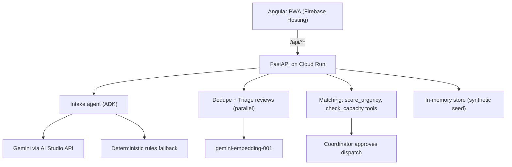

# Relief Desk

**Decision support for flood relief coordinators: who to help first, and why.**
A multilingual crisis-reporting and coordination prototype for the Google Cloud AI Builder Cup 2026, challenge **Sustainability & Social Impact**, built around the Kerala / Kuttanad floods.

> **Prototype. Not an emergency service. In an emergency call 112.** All data in this repository is synthetic.

- **Live app:** https://relief-desk.web.app (health: https://relief-desk.web.app/api/health and `/api/health/ai`)
- **Demo video:** `<Google Drive link>`
- **Coordinator demo:** on the live app, choose "I'm a coordinator", then **Enter as demo coordinator**.

## The problem
During floods, coordinators are buried in messages. The same request arrives many times in different languages, updates get lost, rumours mix with real calls, and the most vulnerable people can be missed in a first-come-first-served queue.

## What it does
- **Report** in English, Hindi, Hinglish, Malayalam or Manglish, by text, voice (`en-IN`/`hi-IN`) or photo. No login for reporters. The reporter gets a receipt in their language and can track status.
- **Understand:** Gemini reads each report into structured facts (type, place, people, vulnerable people, urgency) and keeps the original message.
- **Dedupe:** likely duplicates and updates are flagged with visible evidence. They are **never auto-merged**; a coordinator confirms, and any merge can be undone.
- **Hoaxes are held** for human review, not deleted.
- **Life-threat lane:** reports like oxygen running out or severe bleeding go to the top and tell the reporter to call 112.
- **Rank and match:** vulnerability-weighted urgency with a plain-language reason; teams scored on distance, capacity and urgency. **A human coordinator approves every dispatch.**
- **Public map** shows area-level incidents only: no names, phone numbers or exact addresses.

## Google technology used
| Piece | How it is used |
|---|---|
| **Gemini** (`gemini-3.5-flash-lite`) via the **Google AI Studio API** (`google-genai`) | Intake JSON, duplicate judge, explanations, Ask the desk, photo observations |
| **`gemini-embedding-001`** | Semantic duplicate retrieval (768-d, `SEMANTIC_SIMILARITY`) |
| **Agent Development Kit** (`google-adk==2.11.0`) | Intake, Dedupe, Triage, Matching, Explainer and DispatcherAssist agents; `commit_dispatch` requires human confirmation |
| **Cloud Run** (`relief-desk-api`, asia-south1) | FastAPI backend |
| **Firebase Hosting** | Angular PWA; `/api/**` rewritten to Cloud Run |
| **Secret Manager, Cloud Build, Artifact Registry** | Keys mounted as env vars; `gcloud run deploy --source .` |

## Architecture

Models never set scores or dispatch: Python tools compute urgency and capacity, and the model explains them. Calls run through a priority queue (critical cases first, `AI_CONCURRENCY=2`) with a daily call cap (`GEMINI_DAILY_CALL_CAP=2000`).

## Evaluation (synthetic labels, our own)
- **Gemini vs rules, n=52** (stratified subset of the frozen test split, 18 Oct 2026, `gemini-3.5-flash-lite`): type accuracy 88.6% vs 85.7%; critical cases in top 10: 60% vs 40%; duplicate F1 50.0% vs 16.7%; 0 false merges on hard negatives for both. Subset languages: English, Hindi, Hinglish (no Malayalam/Manglish rows in the split). Small n: one message moves type accuracy ~2.9 points.
- **Rules baseline, n=168** (full frozen split, seed 42): `make bench`, results in `bench/results/RESULTS.md` (2026-10-11).

These are synthetic labels, not real-world accuracy.

## Run locally
```bash
cp .env.example services/api/.env      # put your own GEMINI_API_KEY here; never commit it

# API (from services/api)
pip install -r requirements.txt
python -m uvicorn app.main:app --host 127.0.0.1 --port 8000

# PWA (from repo root)
npm install
npx ng serve web --port 4200

# tests
cd services/api && python -m pytest -q    # Gemini is mocked; no key needed
```
With no key (or `GEMINI_ENABLED=false`) the same fields come from the deterministic rules.

## Deploy
See `deploy/cloudrun.md`: root `Dockerfile` → Cloud Run `relief-desk-api` (asia-south1), Firebase Hosting for `dist/web/browser`, secrets (`GEMINI_API_KEY`, `JWT_SECRET`, `GOOGLE_MAPS_API_KEY`, `SALT_PHONE_HASH`) from Secret Manager.

## Honest notes and limitations
- Prototype with **synthetic data only**; no real personal data is collected.
- Case data lives in process memory (single instance); Firestore is not used.
- If Gemini times out, hits a rate limit or returns invalid JSON, that step uses the deterministic rules and the UI labels it **rules fallback**, never Gemini.
- Language and place understanding can be wrong; the UI always shows the original message.
- Not built: Gemini Live voice, Search grounding, SMS intake, multi-device offline sync.

## Built with
Angular, Ionic, Capacitor, FastAPI, `google-adk==2.11.0`, `google-genai`. Built with help from AI coding tools (Antigravity, Cursor).

## License
`<choose: e.g. MIT — add LICENSE file>`
